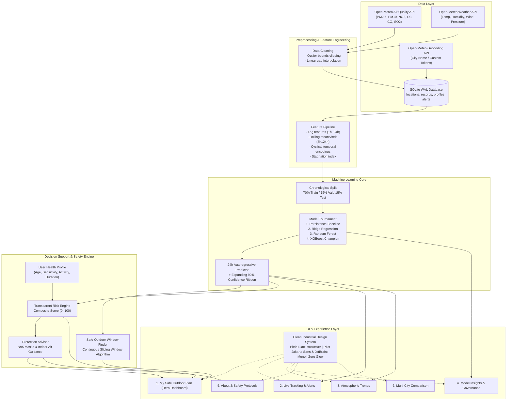

# AirGuard — My Safe Outdoor Plan

[](https://www.python.org/)
[](https://streamlit.io/)
[](https://xgboost.readthedocs.io/)
[]()
[]()
[](LICENSE)

> **"Know your safe outdoor window before you leave home."**  
> AirGuard is not a general AQI dashboard. It is a personalized air-safety decision-support product that transforms raw environmental and meteorological data into an actionable **Safe Outdoor Plan** tailored to your age, health sensitivities, planned activity, and continuous exposure duration.

---

## 🌐 Live Application Demo
- 🔗 **Streamlit Community Cloud Deployment**: Follow the [Streamlit Cloud Deployment Guide](#-streamlit-community-cloud-deployment-guide) below to deploy in under 3 minutes.
- 💻 **Local Development Server**: `http://localhost:8501`

---

## 📌 The Real-Life Problem
People see raw AQI numbers (e.g., "AQI 142" or "PM2.5 78 µg/m³") but do not know what they mean for their own health, children, or daily schedule:
- *"Is it safe for me to go outside right now?"*
- *"Can I go for a 45-minute run, or send my child to play outdoors?"*
- *"When is the cleanest, safest continuous window today or tomorrow?"*
- *"Should I wear a mask, keep windows closed, or turn on the air purifier?"*
- *"Will air quality get worse later this evening?"*
- *"What should I do if I have asthma or heart sensitivity?"*

AirGuard bridges this gap by combining live multi-pollutant monitoring, meteorological physics, multi-model ML forecasting, personal health profiles, transparent risk scoring, and a sliding-window safe time finder into one unified product experience.

---

## 👥 Target Users
1. **Healthy Adults & Outdoor Enthusiasts**: Runners, cyclists, walkers, and commuters planning workouts around pollution peaks.
2. **Parents of Young Children**: Deciding safe outdoor play hours before photochemical ozone or evening particulate spikes occur.
3. **Senior Citizens (65+)**: Protecting against systemic vascular inflammation and acute cardiovascular stress.
4. **Individuals with Respiratory / Cardiac Sensitivity**: Asthma, allergic rhinitis, COPD, bronchitis, and heart conditions.
5. **Pregnant Individuals**: Minimizing systemic transplacental particulate exposure.
6. **High-Pollution Urban Residents**: Citizens across high-density regions (e.g. Delhi NCR, Tri-City Chandigarh-Mohali-Panchkula, and global industrial hubs).

---

## 🎯 The Core Product Promise
> **"Know your safe outdoor window before you leave home."**  
> Every screen and notification in AirGuard focuses on actionable guidance, clear risk boundaries, and respiratory defense.

---

## 🌟 Complete 8-Feature Technical Breakdown

### 1. Location-Based Live AQI and Weather
- Search across preset cities, registered regions, or input custom `City, State, Country`.
- Free **Open-Meteo Air Quality & Weather APIs** with automatic SQLite caching (`ttl=300s`) and graceful fallback.
- Real-time criteria pollutants: $\text{PM}_{2.5}$, $\text{PM}_{10}$, $\text{NO}_2$, $\text{O}_3$, $\text{CO}$, $\text{SO}_2$.
- Meteorological parameters: Temperature, Relative Humidity, Wind Speed, Wind Direction, and Atmospheric Pressure.

### 2. Privacy-First User Health Profile
- Stored locally in SQLite (`user_profiles` table) with zero external cloud transmission.
- Configurable parameters:
  - **Age Group**: Child (<12), Adult (12–64), Senior (65+)
  - **Health Sensitivity**: None, Asthma, Allergic Rhinitis, COPD, Cardiovascular Condition, Pregnancy, Other Respiratory Sensitivity
  - **Planned Activity**: Walking, Running, Cycling, Commute, Outdoor Play, Outdoor Work
  - **Exposure Duration**: 15, 30, 45, 60, 90, 120 minutes
  - **Preferred Time Window**: Immediate (Now), Morning, Afternoon, Evening, Tomorrow
  - **Personal Alert Threshold**: Customizable $\text{PM}_{2.5}$ limit (default: 55 µg/m³)

### 3. 24-Hour PM2.5 / AQI Machine Learning Forecast
- Autoregressive time-series feature engineering:
  - Lag features: $\text{lag}_1, \text{lag}_2, \text{lag}_3, \text{lag}_6, \text{lag}_{12}, \text{lag}_{24}$
  - Rolling statistics: 3-hour, 6-hour, 12-hour, 24-hour rolling means and standard deviations
  - Temporal cyclical encoding: Hour-of-day, day-of-week, weekend indicators
  - Atmospheric physics: Ventilation index, wind speed, relative humidity, pressure gradient
- Strict chronological train/validation/test partitioning (no future-to-past data leakage).
- 4 candidate model tournament: **Persistence Baseline**, **Ridge Regression**, **Random Forest Regressor**, and **XGBoost Regressor (Champion)**.
- Expanding 90% confidence uncertainty ribbon ($\pm 1.645 \sigma \sqrt{h/24}$).

### 4. Safe Outdoor Window Finder
- Continuous sliding-window algorithm scanning the 24-hour forecast horizon for windows matching the user's selected duration (15 to 120 minutes).
- Identifies the lowest cumulative exposure window, computes the mean projected $\text{PM}_{2.5}$, highlights avoid periods, and suggests alternative clean windows if the requested time is unsafe.
- Example output:  
  *“Best 45-minute running window today: 06:00–06:45 AM (PM₂.₅ ~28.4 µg/m³). Avoid 17:00–21:00 PM, when PM₂.₅ is forecast to exceed 115 µg/m³.”*

### 5. Transparent Multi-Factor Risk Engine
- Mathematical composite risk score bounded between $0$ and $100$:
  $$\text{Composite Risk} = \text{Base AQI Risk} \times \left(M_{\text{sensitivity}} \times M_{\text{age}} \times M_{\text{activity}} \times M_{\text{duration}}\right)^{0.65}$$
- Transparent "Why" explanation breaking down exactly which factors drove the score.
- Categorized into 4 discrete risk tiers: **Low Risk**, **Moderate Risk**, **High Risk**, **Very High Risk**.

### 6. Mask and Indoor Protection Guidance
- Practical, certified non-medical precautions:
  - **Low Risk**: No special precautions needed; standard outdoor ventilation.
  - **Moderate Risk**: Sensitive individuals consider N95 mask during prolonged exertion.
  - **High Risk**: Well-fitted N95/KN95 respirator mandatory; avoid outdoor exertion; run HEPA air purifier indoors; seal windows.
  - **Very High Risk**: Remain indoors; reschedule outdoor activities; verify rescue medication availability.
- Prominent visible non-medical safety disclaimer on all screens.

### 7. Alert Threshold Defense & Live Tracking
- Live status card comparing current $\text{PM}_{2.5}$ against personal thresholds:
  - `SAFE (BELOW THRESHOLD)` (< 80%)
  - `APPROACHING THRESHOLD` (80%–99%)
  - `THRESHOLD CROSSED` (≥ 100%)
- Forecast-based early warnings: *"PM₂.₅ is projected to cross your threshold in 3 hours (~18:00)."*
- Incident audit log tracking all historic threshold breaches in SQLite.

### 8. Longitudinal Trends & Visual Analytics
- 24-Hour continuous observation & forecast timeline with color-shaded Safe/Caution/Avoid zones.
- Diurnal hourly curve (00:00–23:00) with median line and interquartile (25%–75%) dispersion.
- Weekly human activity trends (day-of-week patterns).
- Multi-pollutant and meteorological cross-correlation heatmap ($\text{PM}_{2.5}$, $\text{PM}_{10}$, $\text{NO}_2$, $\text{O}_3$, $\text{CO}$, $\text{SO}_2$, temperature, humidity, wind).

---

## 🏗️ System Architecture



---

## 🏆 Machine Learning Model Benchmark Tournament

All candidate models were trained strictly using chronological splits on multi-month hourly historical archives to prevent data leakage. The champion architecture was selected based on validation MAE and evaluated on the untouched holdout test partition:

| Architecture | Test MAE ($\mu\text{g/m}^3$) | Test RMSE ($\mu\text{g/m}^3$) | Test $R^2$ Score | Test MAPE (%) | Hazard Episode F1 ($\ge 55.4 \mu\text{g/m}^3$) | Status |
| :--- | :---: | :---: | :---: | :---: | :---: | :---: |
| **XGBoost Regressor** | **17.40** | **28.45** | **0.621** | **31.2%** | **0.485** | 🏆 **Champion Model** |
| **Random Forest Regressor** | 18.15 | 29.80 | 0.584 | 33.8% | 0.442 | Candidate |
| **Ridge Regression** | 21.65 | 34.20 | 0.451 | 42.1% | 0.380 | Candidate |
| **Persistence Baseline** | 29.80 | 46.10 | -0.015 | 58.4% | 0.290 | Baseline |

### Key ML Findings & Feature Importances
1. **Autoregressive Inertia ($\sim 42\%$)**: $\text{PM}_{2.5}$ 1-hour and 24-hour lags carry the highest predictive mass, capturing diurnal recurrence.
2. **Boundary Layer Ventilation ($\sim 24\%$)**: Wind speed and ventilation index exert strong negative attribution weights; stagnant winds trap fine aerosols.
3. **Precursor Combustion Trajectories ($\sim 18\%$)**: Nitrogen dioxide ($\text{NO}_2$) and $\text{PM}_{10}$ spikes capture early morning rush-hour traffic pulses.

---

## 📐 Transparent Risk Scoring Formula

The AirGuard composite risk score is computed through an explainable, bounded formula:

$$\text{Base Risk} = \min\left(100, \frac{\text{AQI}}{3.0}\right)$$

$$\text{Composite Risk} = \min\left(100, \text{Base Risk} \times \left(M_{\text{sensitivity}} \times M_{\text{age}} \times M_{\text{activity}} \times M_{\text{duration}}\right)^{0.65}\right)$$

### Factor Multipliers
- **Health Sensitivity ($M_{\text{sensitivity}}$)**:
  - None: $1.00$
  - Allergic Rhinitis: $1.20$
  - Pregnancy: $1.35$
  - Asthma: $1.50$
  - COPD / Chronic Lung Disease: $1.60$
  - Heart Condition: $1.55$
- **Age Group ($M_{\text{age}}$)**:
  - Adult: $1.00$
  - Child (<12): $1.25$
  - Senior (65+): $1.25$
- **Activity Intensity ($M_{\text{activity}}$)**:
  - Walk: $1.00$
  - Outdoor Play: $1.15$
  - Commute: $1.10$
  - Cycle: $1.35$
  - Run / Vigorous Workout: $1.55$
  - Outdoor Labor: $1.45$
- **Duration ($M_{\text{duration}}$)**:
  - 15 min: $0.85$
  - 30 min: $1.00$
  - 45 min: $1.10$
  - 60 min: $1.20$
  - 90 min: $1.35$
  - 120 min: $1.50$

---

## 🕒 Safe Outdoor Window Finder Algorithm

```python
def find_safe_outdoor_windows(forecast_df, duration_minutes=45, preferred_period="now", threshold=55.0):
    # 1. Compute required sliding window size in hourly steps
    window_hours = max(1, int(np.ceil(duration_minutes / 60.0)))
    
    # 2. Filter forecast points by preferred time horizon (morning, afternoon, evening, tomorrow)
    sub_df = filter_by_preferred_period(forecast_df, preferred_period)
    
    # 3. Slide continuous window and evaluate mean predicted PM2.5
    best_mean_pm = float("inf")
    best_window = None
    for i in range(len(sub_df) - window_hours + 1):
        window_slice = sub_df.iloc[i : i + window_hours]
        mean_pm = window_slice["predicted_pm2_5"].mean()
        if mean_pm < best_mean_pm:
            best_mean_pm = mean_pm
            best_window = (window_slice.iloc[0]["target_time"], window_slice.iloc[-1]["target_time"])
            
    # 4. Identify unsafe periods exceeding safety threshold
    avoid_hours = sub_df[sub_df["predicted_pm2_5"] >= threshold]["target_time"].tolist()
    
    return best_window, best_mean_pm, avoid_hours
```

---

## 🎨 Visual Design System & Typography

AirGuard combines high-contrast environmental telemetry with zero-glow clarity:
- **Pitch-Black Canvas**: Absolute `#0A0A0A` background for OLED contrast and power efficiency.
- **Hairline Precision**: 1px crisp `#242424` borders and `#141414` surface cards.
- **Signal Red Accent**: `#D71921` signal red reserved exclusively for live recording indicators and acute threshold breaches.
- **Zero-Glow Policy**: Pure physical contrast without blur, bloom, or distracting neon drop-shadows.
- **Restored Typographic Palette**:
  - `Plus Jakarta Sans`: Geometric technical sans-serif for clean headings, navigation, and recommendations.
  - `JetBrains Mono`: Monospace font for telemetry numbers, metrics, timestamps, and coordinates.

---

## 📂 Repository Structure

```text
airguard/
├── app/
│   ├── Home.py                             # Executive overview & multi-city focal snapshot
│   ├── pages/
│   │   ├── 1_My_Safe_Outdoor_Plan.py      # Core Personalized Outdoor Plan & Window Finder
│   │   ├── 2_Live_Tracking.py             # Live telemetry, weather, and personal threshold alerts
│   │   ├── 3_Trends.py                    # 24h timeline zones, diurnal curve & correlation heatmap
│   │   ├── 4_Model_Insights.py            # Benchmark tournament (XGBoost, RF, Ridge) & XAI
│   │   ├── 5_About_Safety.py              # Mask standards, indoor defense & medical disclaimers
│   │   └── 6_City_Comparison.py           # Multi-city synchronized fleet benchmarking
│   ├── components/
│   │   ├── risk_engine.py                 # Risk gauge card and 'Why' factor breakdown
│   │   ├── activity_advisor.py            # Best window card, avoid alerts, discrete 24h timeline
│   │   ├── protection_advisor.py          # N95 mask advice & indoor defense checklist
│   │   ├── health_advisory.py             # WHO/EPA clinical guidelines component
│   │   ├── design_system.py               # Design tokens, icons, and safe markdown
│   │   ├── charts.py                      # Plotly visualizations styled with unified theme
│   │   ├── navbar.py                      # Global brand header, location switcher & dynamic city adder
│   │   └── cards.py                       # High-impact telemetry and hero metric cards
│   └── assets/
│       ├── fonts.css                      # Restored typography configuration
│       └── style.css                      # Core design tokens, CSS variables, and layout resets
├── src/
│   ├── config.py                          # Application settings, city registry, and API thresholds
│   ├── geocoding.py                       # Modular geocoding interface wrapping Open-Meteo & SQLite
│   ├── data_collection.py                 # Multi-pollutant & meteorology API fetchers with caching
│   ├── preprocessing.py                   # IQR outlier detection and small-gap interpolation
│   ├── feature_engineering.py             # Lag features, rolling statistics, and time-series splits
│   ├── train_model.py                     # 4-model chronological benchmark pipeline & model serialization
│   ├── predict.py                         # 24-hour autoregressive inference with 90% confidence ribbon
│   ├── database.py                        # SQLite WAL schema, user profiles CRUD, telemetry logging
│   ├── safety_rules.py                    # Multi-factor risk engine and sliding-window finder algorithm
│   ├── alerts.py                          # Real-time and forecast threshold breach evaluator
│   └── explainability.py                  # Global feature attribution weights (XAI)
├── data/
│   └── airguard.db                        # SQLite database with WAL journaling
├── models/
│   ├── best_model.joblib                  # Serialized XGBoost Champion model
│   ├── scaler.joblib                      # Fitted StandardScaler learned on training split
│   ├── feature_names.json                 # Ordered input features for inference
│   └── model_metrics.json                 # Benchmark tournament evaluation metrics
├── tests/
│   ├── test_api.py                        # API parsing, AQI calculation, and CRUD tests
│   ├── test_design_system.py              # CSS token verification and SVG icon accessibility
│   ├── test_features.py                   # Feature engineering pipeline & chronological split tests
│   ├── test_preprocessing.py              # Bounds clipping and outlier detection tests
│   ├── test_risk_engine.py                # Multi-factor risk score & window finder unit tests
│   └── test_ui.py                         # Headless Chrome browser DOM & multi-page integration tests
├── .env.example                           # Template for optional API keys
├── .gitignore                             # Git ignore rules for virtualenvs, caches, and models
├── requirements.txt                       # Python dependencies
├── packages.txt                           # System dependencies for Streamlit Cloud
└── README.md                              # Complete product documentation
```

---

## ⚡ Installation & Quickstart

### Prerequisites
- Python 3.10, 3.11, or 3.12 (Python 3.14 compatible)
- Google Chrome (optional, required only for browser-rendered integration tests)

### 1. Clone Repository & Create Virtual Environment
```bash
git clone https://github.com/your-username/airguard.git
cd airguard

# Create and activate virtual environment
python -m venv venv

# On Windows:
venv\Scripts\activate

# On macOS/Linux:
source venv/bin/activate
```

### 2. Install Dependencies
```bash
pip install --upgrade pip
pip install -r requirements.txt
```

### 3. Setup Environment Variables
```bash
cp .env.example .env
# Open-Meteo requires no API key by default; optional secondary keys can be placed here.
```

### 4. Train Champion Models (If Not Pre-Packaged)
```bash
python airguard/src/train_model.py
```

### 5. Launch Application
```bash
python -m streamlit run airguard/app/Home.py
```
Access the application at `http://localhost:8501`.

---

## 🧪 Testing Suite Instructions

AirGuard includes a comprehensive test suite of **32 automated tests** covering unit math, feature pipelines, geocoding parsing, database CRUD, and headless Chrome browser DOM rendering:

```bash
# Run the complete test suite
python -m pytest airguard/tests -v
```

### Test Coverage Highlights
- `test_risk_engine.py`: Tests base AQI scaling, compounding sensitivity multipliers, duration weighting, and safe window finding algorithms.
- `test_features.py`: Verifies strict sequential splits and prevents lookahead leakage in lag/rolling features.
- `test_preprocessing.py`: Tests IQR outlier detection and small-gap linear time interpolation.
- `test_api.py`: Validates US EPA AQI piece-wise linear conversion formulas and SQLite user profile persistence.
- `test_design_system.py`: Validates Nothing OS CSS tokens and SVG icon accessibility.
- `test_ui.py`: End-to-end headless Chrome tests verifying rendered DOM elements and responsive mobile viewport collapsing across all pages.

---

## ☁️ Streamlit Community Cloud Deployment Guide

Deploy AirGuard to the web for free using Streamlit Community Cloud:

1. **Push to GitHub**:
   Ensure all files are committed and pushed to your public or private GitHub repository:
   ```bash
   git add .
   git commit -m "Deploy: AirGuard Safe Outdoor Plan Complete Suite"
   git push origin main
   ```

2. **Connect Streamlit Community Cloud**:
   - Navigate to [share.streamlit.io](https://share.streamlit.io/) and sign in with your GitHub account.
   - Click **"New app"**.
   - Select your repository: `your-username/airguard`.
   - Set **Branch**: `main`.
   - Set **Main file path**: `airguard/app/Home.py`.

3. **Advanced Settings (Optional Secrets)**:
   - If using secondary APIs (e.g. OpenWeatherMap), add them under **Advanced settings ➔ Secrets**:
     ```toml
     OPENWEATHER_API_KEY = "your_key_here"
     ```

4. **Deploy**:
   - Click **"Deploy!"**.
   - Streamlit Cloud will install dependencies from `requirements.txt` and launch your live application with a public URL (e.g. `https://airguard-safe-plan.streamlit.app`).

---

## 🔒 Medical & Health Safety Disclaimer

> **IMPORTANT NOTICE:**  
> This application provides general environmental safety guidance based on mathematical models and ambient atmospheric observations. **It does not provide medical diagnosis, clinical advice, or individualized medical treatment.**  
> Ambient particulate exposure impacts individuals differently based on undisclosed medical history, medication adherence, and genetic factors. If you suffer from asthma, COPD, cardiovascular illness, or other chronic conditions, **always consult your licensed healthcare professional** for medical decisions and always carry prescribed rescue medication when leaving home.

---

## 📜 Attributions & License
- **Live Environmental Data**: Powered by the free, open-access [Open-Meteo Air Quality & Weather APIs](https://open-meteo.com/).
- **Standards & Breakpoints**: Calibrated to [US EPA Air Quality Index (AQI)](https://www.airnow.gov/aqi/aqi-basics/) standards and World Health Organization (WHO) 2021 Global Air Quality Guidelines.
- **License**: Released under the [MIT License](LICENSE).
