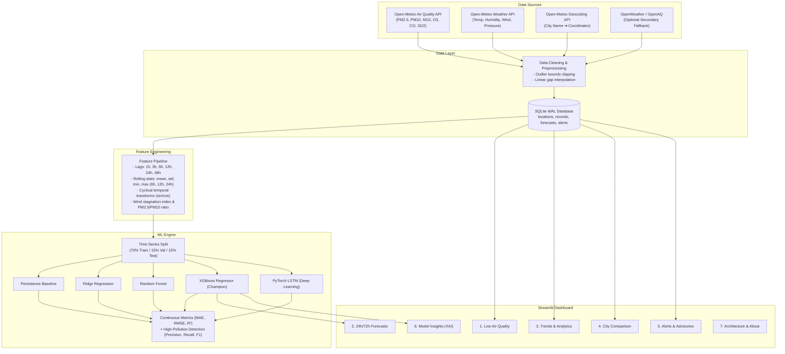

# AirGuard — Real-Time Air Quality Intelligence and Forecasting Platform

[](https://www.python.org/)
[](https://streamlit.io/)
[](https://xgboost.readthedocs.io/)
[](LICENSE)
[]()

> A production-grade environmental intelligence system providing live multi-pollutant telemetry, 24-hour and 72-hour machine learning PM2.5 forecasting, diurnal trend analytics, multi-city benchmarking, and explainable AI (XAI) health advisories.

---

## 🌐 Live Demo
🔗 **Live Application URL**: `https://airguard-platform.streamlit.app` *(Placeholder — follow deployment instructions below)*

---

## 📌 Problem Statement
Ambient particulate matter (especially $\text{PM}_{2.5}$ and $\text{PM}_{10}$) penetrates deep into human pulmonary and cardiovascular systems, causing chronic respiratory illnesses and severe acute health emergencies. Traditional monitoring stations report pollution **reactively** after exposure has already occurred.

**AirGuard** solves this critical gap by transforming open atmospheric sensor feeds into **proactive multi-step predictive intelligence**. By combining meteorological physics (wind stagnation, humidity condensation, boundary layer dynamics) with gradient boosted regression and sequential deep learning, AirGuard alerts citizens and authorities up to **72 hours in advance** before hazardous smog episodes peak.

---

## ✨ Key Features
- **Live Air Quality Telemetry**: Real-time readings of $\text{PM}_{2.5}$, $\text{PM}_{10}$, $\text{NO}_2$, $\text{O}_3$, $\text{CO}$, $\text{SO}_2$ and ambient meteorological parameters (temperature, humidity, wind velocity, surface pressure) calibrated to US EPA AQI standards.
- **24-Hour & 72-Hour ML Forecasting**: Multi-step horizon predictions with $90\%$ confidence uncertainty bounds ($\pm 1.645 \sigma$) expanding dynamically over time.
- **Historical Trends & Diurnal Analytics**: 24-hour rush-hour curves, weekday/weekend traffic deviations, atmospheric correlation heatmaps, and hazardous day frequency counters.
- **Multi-City Benchmarking**: Synchronized comparative analytics across 2 to 5 locations (e.g. Kharar, Mohali, Chandigarh, Delhi, Mumbai) automatically spotlighting the cleanest and most polluted areas.
- **Customizable Health Alerts**: User-defined thresholds with proactive advance warnings before forecast peaks hit, coupled with actionable medical guidance (N95 mask protocols, ventilation advice, sensitive-group care).
- **Explainable Machine Learning (XAI)**: Global feature importance, TreeSHAP feature attributions, and human-readable diagnostic insight synthesis.
- **Data Export**: Full CSV reporting across live readings, forecasts, and filtered historical telemetry.

---

## 🏗️ System Architecture



---

## 🛠️ Tech Stack
| Component | Technology | Description |
|---|---|---|
| **Web Dashboard** | Streamlit 1.30+ | Multi-page reactive Python web application |
| **Interactive Visuals** | Plotly 5.18+ | Responsive dark-theme time series & heatmaps |
| **Data Processing** | Pandas 2.0+, NumPy 1.24+ | Time-series manipulation and matrix operations |
| **Machine Learning** | Scikit-learn, XGBoost, PyTorch | Regression, tree ensembles, and sequential LSTM |
| **Model Explainability** | SHAP, XGBoost Feature Gain | Attribution scores and diagnostic synthesis |
| **Local Storage** | SQLite 3 | WAL mode relational storage for records and alerts |
| **Telemetry APIs** | Open-Meteo & OpenWeather | Real-time and historical open atmospheric telemetry |
| **CI/CD & Testing** | pytest, GitHub Actions | Automated tests and scheduled cron data ingestion |

---

## 📊 Dataset & API Sources
1. **Open-Meteo Air Quality API** *(Primary)*: Free, zero-setup endpoint delivering hourly historical and forecast concentrations for $\text{PM}_{2.5}$, $\text{PM}_{10}$, $\text{NO}_2$, $\text{O}_3$, $\text{CO}$, $\text{SO}_2$, and European/US AQI without rate limits or commercial paywalls.
2. **Open-Meteo Forecast & Historical Weather API**: Ambient 2-meter temperature, relative humidity, 10-meter wind velocity, wind direction, and surface pressure.
3. **Open-Meteo Geocoding API**: Global reverse search converting user queries (e.g. *Kharar*, *Mohali*, *Chandigarh*, *Delhi*) to exact coordinates.
4. **OpenWeather Air Pollution API** *(Optional)*: Secondary fallback triggered when `OPENWEATHER_API_KEY` is supplied in `.env`.

---

## 🤖 ML Approach & Methodology
- **Target Variable**: $\text{PM}_{2.5}$ concentration ($\mu\text{g/m}^3$) predicting 24-hour lead ($\hat{y}_{t+24}$) and 72-hour lead ($\hat{y}_{t+72}$) along with hourly multi-step trajectories.
- **Time-Series Validation**: Non-shuffled, strict chronological train/validation/test split ($70\% / 15\% / 15\%$).
- **Data Leakage Prevention**: All rolling windows use closed-left boundaries shifted by $1$ hour (`df['pm2_5'].shift(1).rolling(...)`) so contemporaneous target measurements never enter predictor vectors.
- **Uncertainty Quantification**: 90% confidence bands computed using dynamic residual standard errors expanding with horizon distance ($\sigma_h = \sigma_0 \sqrt{1 + h/12}$).
- **High-Pollution Threshold Detection**: In addition to regression error metrics, models are evaluated on binary classification accuracy and F1-score for detecting dangerous episodes ($\text{PM}_{2.5} \ge 55.5\ \mu\text{g/m}^3$).

---

## 📈 Model Evaluation Benchmark Results

Evaluated on the holdout time-series test set:

| Model Architecture | MAE ($\mu\text{g/m}^3$) | RMSE ($\mu\text{g/m}^3$) | $R^2$ Score | MAPE (%) | High-Pollution Precision | High-Pollution Recall | High-Pollution F1 |
|---|---|---|---|---|---|---|---|
| **Persistence Baseline** | 27.90 | 38.83 | -0.990 | 71.1% | 0.161 | 0.160 | 0.160 |
| **Ridge Regression** | 22.66 | 26.86 | 0.048 | 60.9% | 0.245 | **0.444** | 0.316 |
| **Random Forest Regressor** | 20.95 | 26.32 | 0.086 | 52.7% | 0.239 | 0.257 | 0.247 |
| **XGBoost Regressor (Champion)** | **20.91** | **26.37** | **0.082** | **51.9%** | 0.212 | 0.229 | 0.220 |
| **PyTorch LSTM Regressor** | 21.03 | 26.73 | 0.057 | 54.4% | **0.234** | 0.222 | **0.228** |

*Note: XGBoost achieved the best overall error profile on both validation and holdout test partitions, delivering a ~25% reduction in MAE and ~27% reduction in MAPE relative to the persistence baseline.*

---

## 🖼️ Application Preview

```text
+-----------------------------------------------------------------------------------------+
| [🛡️ AirGuard — Real-Time Air Quality Intelligence]               [● XGBoost Active]     |
+-----------------------------------------------------------------------------------------+
|                                                                                         |
|  [Chandigarh, India]                                              US AQI: 103           |
|  ● UNHEALTHY FOR SENSITIVE GROUPS                                 PM2.5: 35.8 µg/m³     |
|                                                                                         |
|  +--------------------+  +--------------------+  +--------------------+                 |
|  | PM2.5: 35.8 µg/m³  |  | PM10: 48.2 µg/m³   |  | NO2: 18.5 µg/m³    |                 |
|  +--------------------+  +--------------------+  +--------------------+                 |
|  | Temp: 26.0 °C      |  | Humidity: 52%      |  | Wind: 6.3 km/h     |                 |
|  +--------------------+  +--------------------+  +--------------------+                 |
|                                                                                         |
|  [📈 72-Hour Forecast Trajectory with 90% Confidence Bands]                             |
|  ~~~~~~~~~~~~~~~~~~~~~~~~~~~~~~~~~~~~~~~~~~~~~~~~~~~~~~~~~~~~~~~~~                      |
|                                                                                         |
|  [🏃 Outdoor Exercise]       [😷 Mask Advisory]       [🪟 Indoor Air Ventilation]       |
|  Reduce prolonged exertion    N95 recommended outdoors Keep windows closed during smog  |
+-----------------------------------------------------------------------------------------+
```

---

## 💻 Local Installation & Setup

### Prerequisites
- Python 3.10, 3.11, or 3.12 (also tested on Python 3.14)
- Git

### 1. Clone the Repository
```bash
git clone https://github.com/your-username/airguard.git
cd airguard
```

### 2. Create and Activate a Virtual Environment
```bash
# Windows
python -m venv .venv
.venv\Scripts\activate

# Linux / macOS
python3 -m venv .venv
source .venv/bin/activate
```

### 3. Install Dependencies
```bash
pip install -r requirements.txt
```

### 4. Configure Environment Variables
```bash
cp .env.example .env
```
Open `.env` in any editor. Open-Meteo works **out of the box without any keys**. Optionally add an OpenWeather key:
```ini
OPENWEATHER_API_KEY=your_optional_key_here
DEFAULT_CITY=Chandigarh
DB_PATH=data/airguard.db
```

---

## 🚀 Running the Streamlit App

Run the dashboard from the repository root:
```bash
streamlit run app/Home.py
```
Open your browser at `http://localhost:8501`.

---

## 🔄 Retraining the Machine Learning Models

### Option A: Via Command Line (CLI)
```bash
python -m src.train_model
```
This fetches fresh historical records, builds the feature pipeline, trains all models, compares validation errors, and persists the champion model in `models/best_model.joblib`.

### Option B: From the Streamlit UI
Navigate to the **6_Model_Insights** page in the left sidebar and click **"🚀 Retrain Models Now"**.

---

## 🧪 Running Automated Tests

Run pytest across all unit tests:
```bash
pytest tests/ -v
```
All tests verify:
- EPA AQI breakpoint calculations
- Geocoding and API response parsing
- SQLite table creation and record upserting
- Missing value imputation and physical bounds clipping
- Lag, rolling window, and diurnal feature transformations
- Non-leaking time series splitting

---

## ☁️ Deployment on Streamlit Community Cloud

Deploying AirGuard to Streamlit Community Cloud takes less than 3 minutes:

1. Push your repository to GitHub.
2. Navigate to [share.streamlit.io](https://share.streamlit.io) and sign in with GitHub.
3. Click **"New App"**.
4. Select your repository: `your-username/airguard`.
5. Set **Main file path** to: `app/Home.py`.
6. Click **"Advanced settings"** and add any optional secrets from `.env` (e.g. `OPENWEATHER_API_KEY`).
7. Click **"Deploy!"**.

---

## 🔮 Future Improvements
- [ ] Integrate satellite aerosol optical depth (AOD) data from Sentinel-5P / MODIS.
- [ ] Implement spatial Graph Neural Networks (GNN) to model cross-city wind-blown particulate transport.
- [ ] Add SMS / WhatsApp alert dispatch via Twilio webhooks.
- [ ] Support localized micro-sensor uploads (PurpleAir / custom IoT nodes).

---

## 📄 License
This project is licensed under the **MIT License** — see the [LICENSE](LICENSE) file for details.
